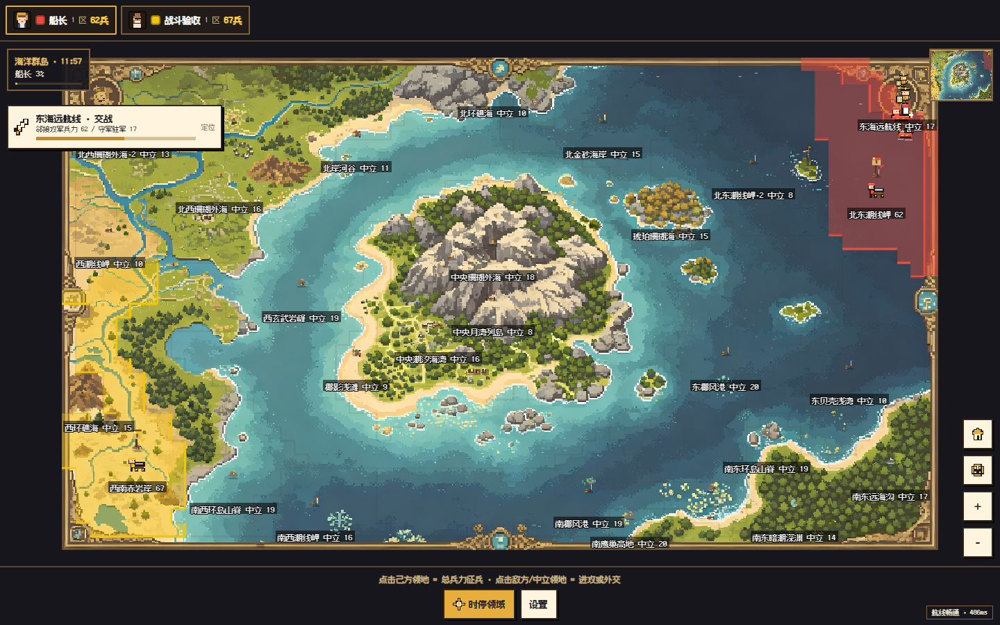
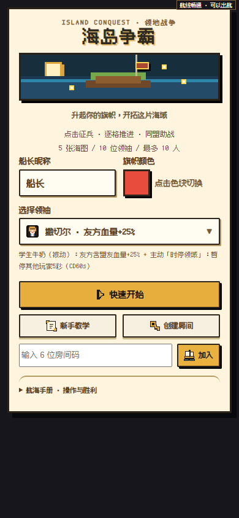
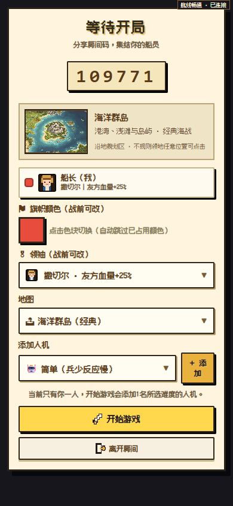
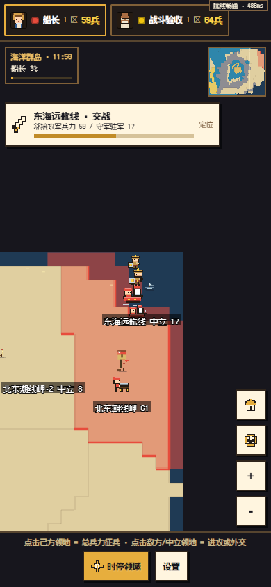

# 海岛争霸 · 领地战争

像素风多人联机领地策略游戏。点击己方区域征兵，向相邻领地进攻；用军营、外交和领袖技能推进战线，争夺整张地图。

Node.js + Colyseus 权威服务器，原生 Canvas 客户端；电脑和手机浏览器共用一份游戏，支持局域网联机。



## 现在可以玩什么

- 五张地图：海洋群岛、热带雨林、雪地高原、黄金沙漠和 96×96 超大地图。
- 每局 2–10 个席位，支持真人与简单、普通、困难三档人机；单人点开始会自动添加一名人机。
- 整区点选征兵和相邻进攻，多方渐进战线、军营、结盟、宣战、停战与求和。
- 十位领袖的主动/被动技能，以及教程、淘汰观战、结算和重赛。
- 五类统一 24×24 像素兵种：待机、行军、攻击、受击和倒地；屏幕单位是代表阵列，兵力以数字为准。
- 有条件的原房重连：180 秒窗口内、原服务进程与房间仍存在时恢复；不提供跨服务重启存档。

<table>
<tr><th>首页</th><th>房间设置</th><th>手机战况定位</th></tr>
<tr>
<td></td>
<td></td>
<td></td>
</tr>
</table>

以上是 2026-10-10 已有真实网页版 QA 截图，不是微信或抖音小游戏原生包的画面。

## 快速开始

需要 Node.js 18 或以上；现有 Dockerfile 使用 Node.js 22。

```bash
git clone https://github.com/TrueYuanYing/territory-war.git
cd territory-war
npm ci --prefix server
npm start
```

电脑打开 [localhost:8080](http://localhost:8080)。Windows 也可双击 `启动服务器.bat`，首次运行会安装服务端依赖并打印入口。

手机需连接同一可互通的 Wi-Fi，访问启动日志中的电脑局域网地址，例如 `http://<电脑IPv4>:8080`。手机上的 localhost 是手机自身，不能用于访问电脑；同时检查 TCP 8080 防火墙和路由器客户端隔离。

## 怎么玩

1. 首页选昵称、颜色和领袖，创建六位码房间、输入好友房间码或快速匹配。
2. 房主选地图、添加人机并开始。房间只有自己时会自动补一名人机；已有对手时不额外添加。
3. 点己方区域任意位置征兵；点相邻中立区域进攻。对其他玩家先按外交关系宣战，不要求精确点击旗帜或区域中心。
4. 观察驻军、战线和战况卡，使用主动技能与外交。发出求和请求不会阻断正常进攻。
5. 消灭对手，或占领 80% 并保持 10 秒；标准图 12 分钟、超大图 15 分钟结束时也会按领土和兵力判定。

特殊规则、十位领袖技能、视角与断线说明见 [玩法说明](docs/GAMEPLAY.md)。游戏当前包含真实历史或政治人物及梗化文案；平台发布前需单独核查内容要求，不将其声明为全部虚构。

## 运行与部署

服务默认监听 8080，可通过进程环境变量 `PORT` 调整；无需 API key 或 `.env` 才能本地游玩。`/healthz` 用于探活，`/version` 返回当前前后端内容 hash。

```bash
docker build -t territory-war .
docker run --rm -p 8080:8080 territory-war
```

服务端房间存在单进程内存中。云托管若要避免空闲冷启动，可配置常驻实例；增加副本前应先设计共享房间路由。不要直接认为多副本能共享现有对局。

原 CloudBase 服务的测试入口：[试玩](https://territory-war-297872-11-1469658819.sh.run.tcloudbase.com)。首次可能需要正常确认腾讯云测试域名提示；它不是稳定性或永久可达保证。本次 GitHub 整理不重新部署云端；自建服务请使用自己的账号、环境和域名。

`render.yaml` 仅保留备用配置，不代表当前套餐、可用额度或实际托管位置；使用前按目标平台现行要求核实。

## 测试和维护

```bash
npm ci
npm test
```

默认执行服务端、前端内联脚本及维护脚本语法检查，随后执行 16 项无需已运行游戏服务的行为/资源测试。测试范围与需要另开服务的集成测试见 [测试说明](tests/README.md)。

```bash
npm run sprites:build
npm run font:build
npm run font:check
```

上述命令分别维护兵种帧和局内字体子集。运行游戏不需要先重建素材，也不需要下载浏览器或第三方 CDN。

```text
server/          权威房间、HTTP 与 WebSocket 服务
public/          Canvas 页面、客户端 SDK、地图与像素素材
terrain-*.json   地形蒙版
tests/           精选行为、资源与联机回归
tools/art/       当前兵种源与同步工具
tools/fonts/     字体子集构建工具
docs/            玩法、维护说明和真实截图
licenses/        第三方 SDK 与字体来源留档
```

## 已知边界

手机跨设备与低端手机长局表现仍需更多实机验证；常驻实例不等于永不断线，减少绘制调用也不等于 FPS 同比例提升。混合绿洲、林缘等区域以蒙版主要地貌归类，不是逐像素人工精标。

当前是网页游戏，没有接入微信/抖音登录、广告、支付或防沉迷 SDK。代码公开与软著登记、平台资质、内容审批和商业运营是不同事项。

## 许可与来源

自有代码与文字文档使用 [MIT](LICENSE)。自有地图、角色肖像设计和展示截图保留版权，见 [美术使用范围](ARTWORK_LICENSE.md)；明确 CC0 的兵种、图标和 Kenney 素材，以及 OFL 字体不受该保留条款覆盖。第三方 SDK 保留原许可，详见 [来源说明](THIRD_PARTY_NOTICES.md)。

本项目使用 AI 辅助开发。需求、审美选择与体验反馈来自实际使用过程；不把第三方代码或素材称为全部人工独立原创。

更多项目：[游戏设计 · 具身智能 · 软件设计](https://github.com/TrueYuanYing#项目分类)。
